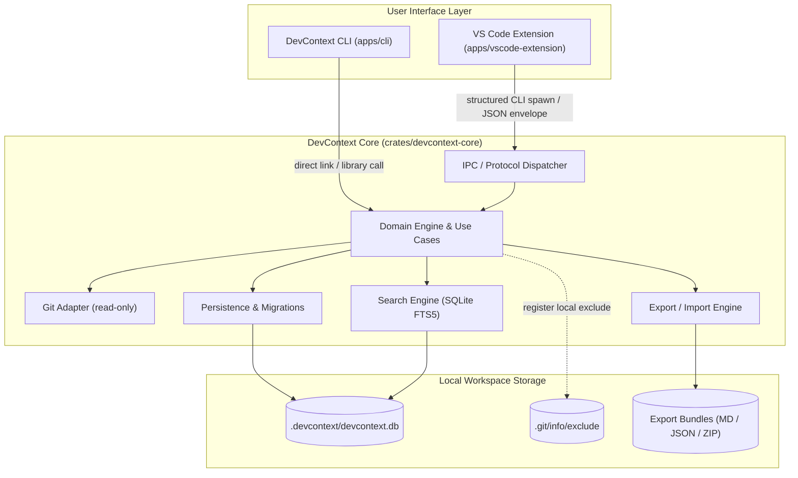

# DevContext --- Architecture Overview

- **Status:** Approved for Phase 0
- **Version:** 1.0.0
- **Last Updated:** 2026-10-30

---

## 1. System Architecture

DevContext is designed as a modular, local-first system. Business logic, storage, search, and Git analysis reside entirely within a native Rust core. The user interfaces (CLI and VS Code Extension) act as thin, typed presentation layers communicating with the core via structured execution.



---

## 2. Key Subsystems & Responsibilities

### 2.1 Core Domain (`crates/devcontext-core`)
- **Domain Models:** Strongly typed entities representing `Project`, `Record`, `Note`, `Decision`, `Milestone`, `LogEntry`, `SavedCommand`, and `Reference`.
- **Validation:** Domain constraints (e.g. valid decision status transitions, title length, safe relative paths).
- **Use Cases:** Atomic operations for creating, updating, superseding, searching, and deleting records.

### 2.2 Persistence & Storage Layer (`devcontext-core::storage`)
- Embedded **SQLite 3** engine with WAL mode and foreign key enforcement.
- Transactional database migrations tracked in `schema_migrations`.
- Dedicated envelope table `records` with typed extension tables for specific entities.
- Backup creation and restore primitives.

### 2.3 Search Subsystem (`devcontext-core::search`)
- SQLite **FTS5** virtual table (`records_fts`) maintained automatically via SQLite triggers or explicit domain repository transactions.
- Provides snippet generation, prefix matching, and token ranking.
- Fallback query planner for non-FTS environments if needed.

### 2.4 Git Adapter (`devcontext-core::git`)
- Bounded, read-only Git operations (reading HEAD, branch name, commit metadata).
- Never mutates Git history, index, or hooks.
- Assembles combined chronological timeline by merging commit metadata with DevContext records.

### 2.5 Export / Import Engine (`devcontext-core::export`)
- Serializes records into:
  1. Human-readable Markdown folders with YAML frontmatter.
  2. Strict JSON v1 schema (`schemas/export-v1.schema.json`).
  3. Portable ZIP archives.
- Deserialization with strict schema validation, ID collision detection, path sanitization, and pre-import backups.

### 2.6 VS Code Extension (`apps/vscode-extension`)
- Built in TypeScript using the official VS Code Extension API.
- Managed and built with **Bun**.
- Native Tree Views for Notes, Decisions, and Milestones.
- Interactive Webview/QuickPick for Search and Timeline.
- Dispatches operations by invoking the native `devcontext` CLI binary with `--json` structured arguments. Never executes raw shell strings.

---

## 3. Storage & Directory Layout

```text
<project-root>/
├── .devcontext/
│   ├── devcontext.db          # SQLite 3 database (WAL mode)
│   ├── devcontext.db-wal      # SQLite write-ahead log
│   ├── devcontext.db-shm      # SQLite shared memory
│   ├── backups/               # Automated pre-import and maintenance snapshots
│   └── attachments/           # Optional local attachments
└── .git/
    └── info/
        └── exclude            # Automatically updated with .devcontext/
```

---

## 4. Privacy & Security Architecture

1. **Local-Only Boundary:** DevContext makes zero outbound network calls and contains no telemetry code.
2. **Untrusted Input Treatment:** All imported JSON archives and shell command inputs are treated as untrusted data, requiring strict schema validation and path traversal checks.
3. **No Automatic Command Execution:** Saved shell commands are stored inertly as text and are never executed without affirmative user confirmation.
4. **Credential Protection:** Command inputs are evaluated with regex heuristics to warn against accidentally persisting tokens or private keys.
